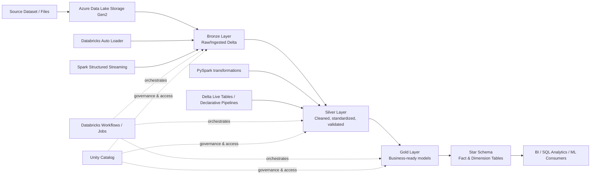

# Azure Databricks End-to-End Data Engineering Project
## Project Overview
This project is a hands-on Azure Databricks data-engineering walkthrough that builds an end-to-end lakehouse workflow. It covers data ingestion, processing with PySpark, incremental/streaming concepts, Delta Lake, data modeling, and orchestration.
This README is a learning companion and project documentation. The notebook headings below are suggested logical sections for organizing and understanding the work, not verified original notebook filenames. The repository currently exposes a Databricks .dbc archive and sample Parquet files; use the actual imported workspace notebooks to confirm the precise notebook names and contents.

## High-Level Architecture

## Architecture at a Glance
### Component	Role
Azure Data Lake Storage Gen2-	Cloud storage for the lakehouse data files/layers
Azure Databricks-	Spark-based data engineering and analytics workspace
Auto Loader	Incremental file ingestion pattern for new files
PySpark	Distributed transformations using Spark DataFrames and functions
Spark Structured Streaming	Streaming processing with checkpointing/stateful capabilities where configured
Delta Lake	Table storage layer supporting ACID transactions and features such as history/time travel (depending on configuration)
Unity Catalog	Central data governance, catalog/schema/table organization, permissions, and discovery
Delta Live Tables (DLT) / declarative pipelines	Define managed data transformation pipelines, dependencies, and quality rules (terminology/UI may evolve)
Databricks Workflows / Jobs	Orchestrate tasks, notebook dependencies, and scheduled/manual runs
Star Schema	Analytical model with fact and dimension tables for business queries

### Medallion Layers
## Bronze — Raw/Ingested Data
- Bring source files/data into the lakehouse.
- Keep a source-faithful representation where practical.
- Store as Delta tables in this implementation pattern.
- Ingestion may use batch, Auto Loader, or streaming depending on the exercise.
- Keep ingestion metadata when implemented (for example, file/source and load-time details).
## Silver — Cleaned and Standardized Data
- Apply data-quality checks and validations.
- Clean and standardize fields, formats, and types.
- Handle duplicate records and invalid values.
- Apply business-independent transformations and enrichment.
- Support incremental processing where the notebook/pipeline is designed for it.
## Gold — Business-Ready Data
- Integrate datasets to answer business questions.
- Create fact and dimension tables using dimensional modeling.
- Apply business rules and aggregations.
- Implement SCD logic when required to preserve dimension history.
- Make tables/views ready for reporting and downstream analytics.

## Notebook Learning Map
Use these as a mental guide when studying the imported .dbc archive. The exact notebook names may differ.
Notebook / logical section	Purpose	Key ideas to understand
1. Environment & Catalog Setup	Set up workspace access, storage, catalog/schema, and configuration	Workspace, compute, Unity Catalog, permissions, storage paths
2. Data Exploration / Understanding	Inspect source files and understand columns, keys, and business meaning	Schema, data profiling, nulls, relationships, source formats
3. Initial / Batch Ingestion	Load source files into the Bronze layer	Batch load, file formats, schema, Delta tables
4. Auto Loader Ingestion	Incrementally discover and ingest arriving files	CloudFiles, schema inference/evolution concepts, checkpointing
5. Structured Streaming	Process incoming records as a stream	Streaming DataFrames, micro-batches, checkpointing, triggers
6. PySpark Transformation Basics	Transform datasets using DataFrame APIs	select, filter, joins, groupBy, expressions, built-in functions
7. Advanced PySpark / Reusable Logic	Use more advanced transformations and reusable code patterns	Window functions, conditional logic, functions, classes, modularity
8. Slowly Changing Dimensions	Maintain dimension history when attributes change	SCD Type 1 vs Type 2, merge/upsert logic, effective dates/current flags
9. Declarative Pipeline / DLT	Build managed transformation pipelines and quality checks	Dependencies, expectations/quality rules, pipeline refreshes
10. Star Schema Modeling	Create analytics-friendly fact/dimension structures	Grain, keys, fact measures, dimension attributes, relationships
11. End-to-End Workflow	Connect notebook/pipeline tasks and execute them in dependency order	Jobs/Workflows, task dependencies, schedules, monitoring, retries

## Pipeline Walkthrough
A. Ingestion into Bronze
1. Source data/files arrive in cloud storage or are made available to the ingestion process.
2. Batch ingestion or Auto Loader reads the data.
3. The source data is landed into Bronze Delta tables.
4. Ingestion metadata and checkpointing may be maintained depending on the specific method.
### Why Bronze? It gives the project a recoverable starting point and keeps ingestion separate from cleaning/business logic.
B. Bronze to Silver
1. Read Bronze tables.
2. Validate and clean fields.
3. Standardize formats and data types.
4. Remove or resolve duplicates where rules allow.
5. Apply quality rules and enrichment.
6. Write cleaned data into Silver Delta tables.
### Why Silver? Different source datasets become more consistent and reliable for later modeling.
C. Silver to Gold
1. Identify the business process and define the grain for each fact table.
2. Define dimensions and their descriptive attributes.
3. Create keys and relationships.
4. Apply business calculations and aggregates.
5. Implement SCD behavior when historical tracking is required.
6. Publish Gold tables/views for analytics.
### Why Gold? It provides a business-focused model so reporting and analytical queries don't need to repeat complex transformations.
D. Orchestration with Workflows / Jobs
A workflow coordinates the execution sequence. Conceptually, it may run ingestion tasks first, then transformation tasks, then dimensional-modeling tasks. Configure task dependencies so a downstream task waits for its upstream task to finish successfully. Workflows can also provide schedules, run status, logs, retries, and alerting depending on setup.
E. Declarative Pipeline / DLT
Declarative pipelines describe datasets and their dependencies, with the platform managing pipeline execution. In the project, use the pipeline section to learn how to define transformations, quality expectations, and pipeline updates. Delta Live Tables terminology and the current Databricks pipeline UI may differ from newer product terminology.
##Batch vs Incremental vs Streaming
Method	Meaning	Example use
Batch	Process a bounded set of data at a time	Initial/full source load
Incremental	Process only new or changed data since a prior run	Newly arrived files or changes
Streaming	Continuously or repeatedly process arriving events/data	Near-real-time event ingestion

Auto Loader is primarily a file-ingestion mechanism that can support incremental discovery of new files. Spark Structured Streaming is Spark's streaming-processing framework. These concepts are related but are not interchangeable.
## Data Modeling Topics to Watch Closely
- Grain: What does one row in a fact table represent?
- Fact table: Quantifiable events or measurements (e.g., a transaction, order line, or activity).
- Dimension table: Descriptive context used to slice facts (e.g., customer, product, date, location).
- Star schema: Fact table surrounded by dimensions, usually designed for easier analytical querying.
- SCD Type 1: Overwrite an old attribute value; history is not preserved for that attribute.
- SCD Type 2: Insert a new version of a dimension record to preserve history, usually with validity dates/current-row indicators.
Modeling isn't only a Gold-layer activity in every architecture. Source/raw structures exist in Bronze and cleaned/integrated structures in Silver, but Gold is often where explicit business-facing dimensional models are created.

## Key Terms
- ADLS Gen2: Azure Data Lake Storage Gen2.
- ETL: Extract, Transform, Load.
- Delta table: Table stored using Delta Lake format/features.
- Auto Loader: Databricks mechanism for incrementally processing files arriving in cloud storage.
- Structured Streaming: Spark's streaming API.
- DLT: Delta Live Tables, a managed declarative data-pipeline capability; terminology may be changing in Databricks product UI/docs.
- Workflow/Job: Orchestration that runs tasks in sequence or based on dependencies.
- Unity Catalog: Data governance and access-control layer for Databricks data assets.
- SCD: Slowly Changing Dimension technique to manage changing dimension attributes.
## Project Learning Outcomes
By completing and understanding this project, aim to be able to explain:
- How source files/data are ingested into a lakehouse.
- Why Bronze, Silver, and Gold are separated.
- How Auto Loader differs from a one-time batch read.
- What Structured Streaming does and how checkpointing helps.
- How PySpark DataFrame transformations work.
- How Delta tables support reliable table operations.
- How SCD Type 1 and Type 2 differ.
- How a star schema is designed and why grain matters.
- How a Workflow orchestrates notebooks/tasks.
- How governance and access are organized through Unity Catalog.
